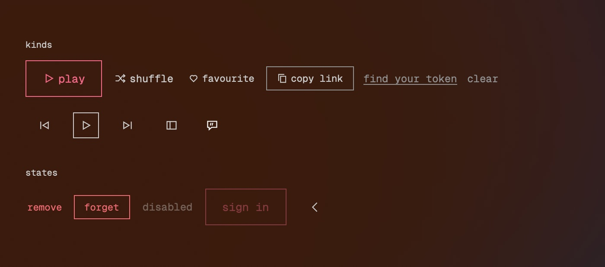
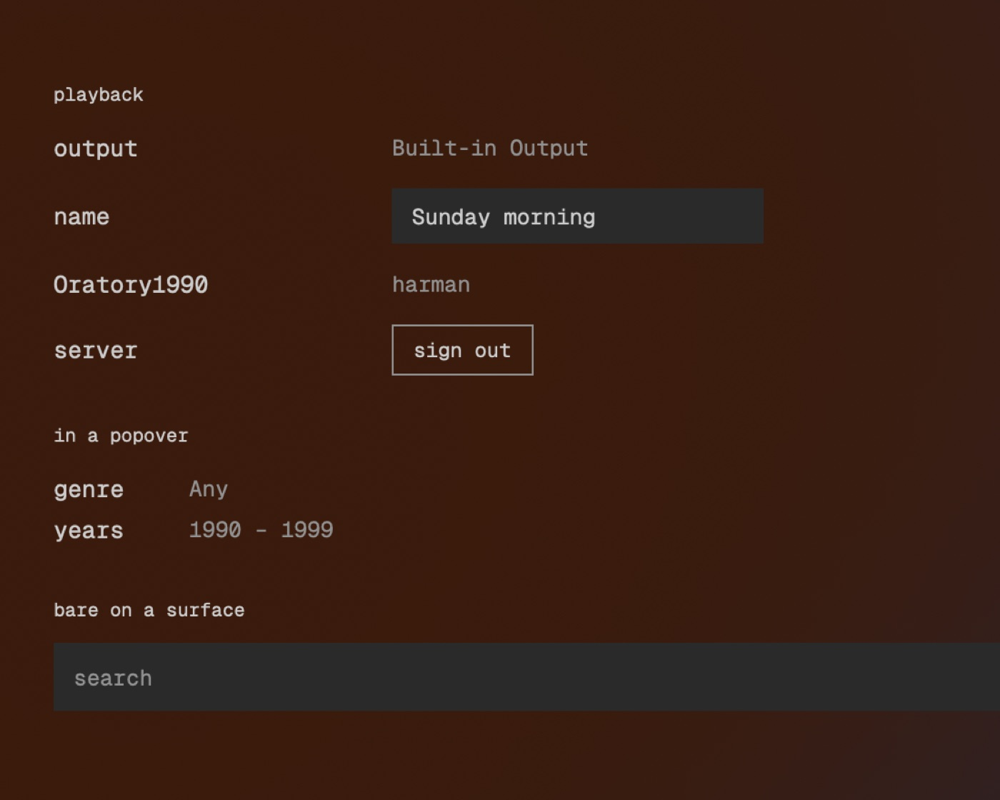
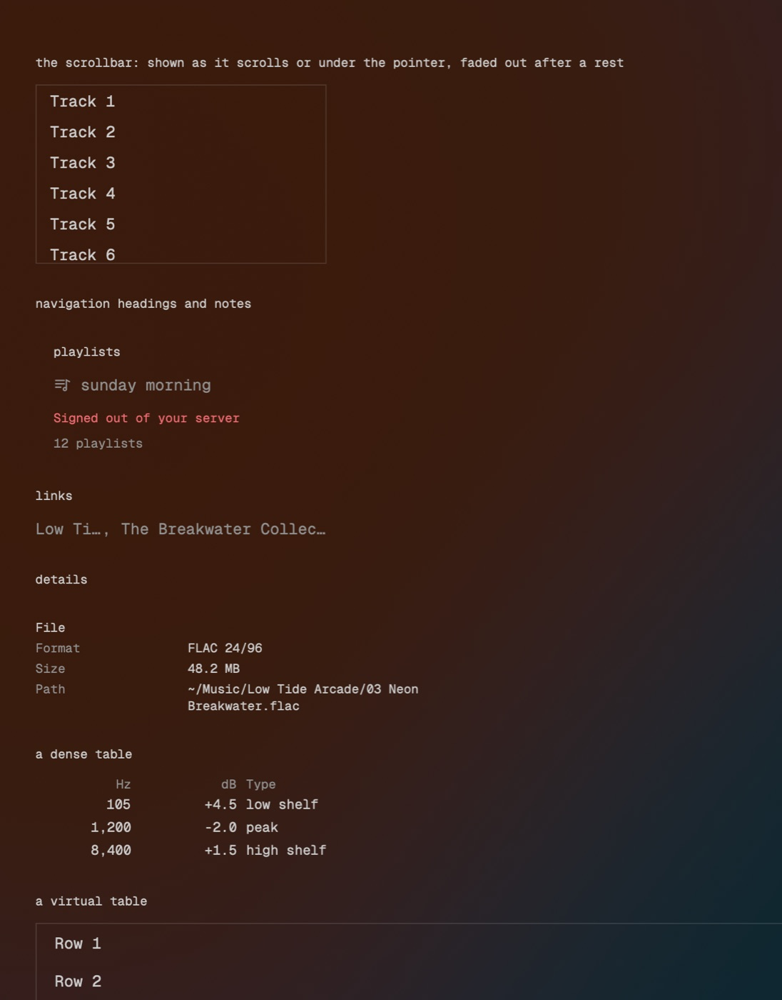
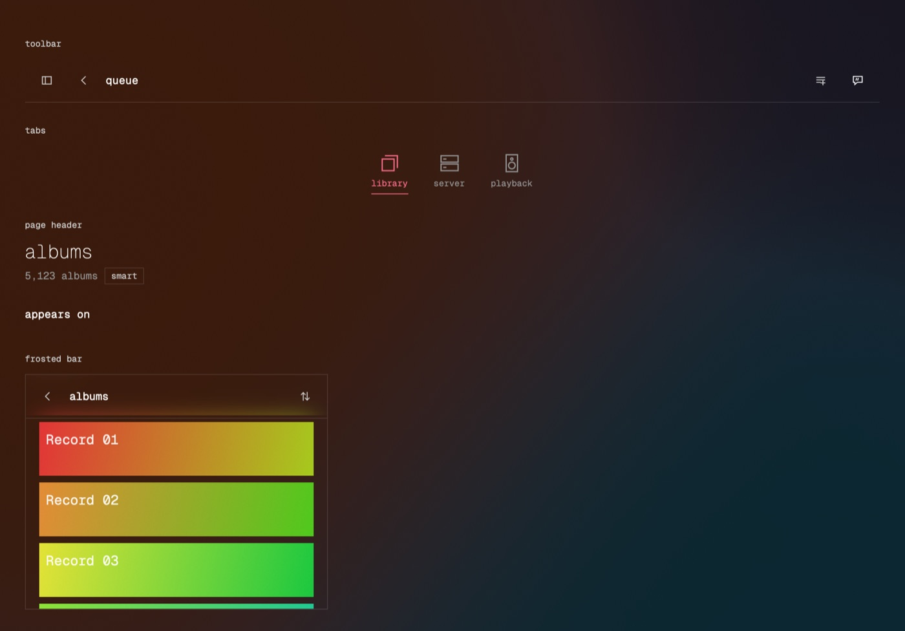

# koan-kit

koan-kit is the design system the kōan GUI app is built from: a theme and a set of components for [GPUI](https://www.gpui.rs), the UI framework from the Zed editor, taken from kōan's fork of it. It runs on macOS, Linux and iOS. It knows nothing of music or of kōan's engine, so an app of any kind can be built on it.

This page introduces the kit and shows its intended use. The [API reference](../reference/koan-kit-api.md) lists every public item with its documentation, generated from the source. The guide and the reference are also published together as one plain-text file, [koan.rocks/koan-kit.txt](https://koan.rocks/koan-kit.txt), for a reader such as a language model that takes a single document.

## What it provides

GPUI gives a page `div()`s, and each one accepts any padding, size and colour. A page assembled from those choices drifts from every other page. koan-kit puts containers back between the page and GPUI, so the page states what it shows and the kit decides the rest:

- **Containers that own their layout.** `Page` and `PageHeader`, `Toolbar`, `Form` with its sections and rows, `TableRow` and the lists built from it, `Collection`, `SplitView`, `Inspector` and sheets each own their margins, gaps, row heights and type. A page cannot set them, so pages built from the kit look the same.
- **Controls with their states.** Buttons, toggles, segmented controls, sliders, steppers, text and filter fields, menus, pickers and badges, each with hover, press, focus, disabled and selected states, keyboard access and an accessible name.
- **Tokens resolved per window.** `Look::of(window, cx)` gives the palette, type roles, spacing scale and motion for the window's appearance, text size and accent. Components take semantic parameters (a `Tone`, a `TypeRole`, a `ButtonKind`) and never a colour or a size in points.
- **Motion drawn on the GPU.** Transitions, glides, the wash behind the window and the playing indicators are keyframes a shader interpolates at present time, so a moving element costs no layout or paint on the CPU (`Animated`, `Glide`, `Veil`, `Rise`, `SlideUp`).
- **The system's settings.** Reduce Motion, Increase Contrast, Reduce Transparency and the system text size are read where the platform provides them and applied by every component.
- **Touch.** On a touch screen every control keeps a 44-point target, a long press opens the context menu, and a window narrower than 660 points takes the compact layout (`Look::touch`, `Look::compact`).

The kit is compositional, in the manner of atomic design. Atoms are the indivisible parts (`Text`, `KoanIcon`, `Button`, `Divider`, the spacing steps); molecules put a few atoms together for one job (`TwoLines`, a title over a subtitle; `ControlGroup`, touch-sized controls on one rhythm; a `TableRow`); and a few generic organisms lay molecules out (bars, sheets, the page). Something specific to one app, such as kōan's mini player, is the app's composition of these parts, not a component of the kit.



## Depending on it

koan-kit is not yet published to crates.io. Depend on it from the kōan repository, and on GPUI at the revision the kit uses, which is pinned in kōan's root `Cargo.toml`. The `gpui` dependency is needed only because GPUI's derive macros name it; everything a page uses comes through `koan_kit`.

```toml
[dependencies]
koan-kit = { git = "https://github.com/radiosilence/koan" }
gpui = { package = "gpui-koan", git = "https://github.com/radiosilence/zed", rev = "<the rev in kōan's Cargo.toml>" }
```

A kit change is tested against kōan's own pages and its storybook before it lands, and the reference is regenerated with it, so the reference at a commit describes the kit at that commit.

## A first window

The example below is `crates/koan-kit/examples/first_window.rs`, and `cargo run -p koan-kit --example first_window` opens it. It shows the shape of every koan-kit app: `theme::init` and the icon set at startup, a window opened through the kit (`SecondaryWindow` here, `MainWindow` for an app's main window), and a view whose `render` composes containers and controls.

<!-- example: crates/koan-kit/examples/first_window.rs -->
```rust
//! A first window on koan-kit: a page whose header and form come from the
//! kit, a toggle and a choice the view keeps, and a button that puts them
//! back. Nothing in it sets a size, a colour or a gap: the page, the form
//! and the controls own those. The guide's first example
//! (`docs/guide/koan-kit.md`) is this file.
//!
//! cargo run -p koan-kit --example first_window

use koan_kit::app::*;
use koan_kit::components::{
    Button, ButtonKind, Form, FormRow, FormSection, Page, PageHeader, SecondaryWindow, Segmented,
    Toggle,
};
use koan_kit::theme::{self, Look};

/// The view: what the page shows, and nothing about how it looks.
struct Playback {
    shuffle: bool,
    quality: usize,
}

impl Render for Playback {
    fn render(&mut self, window: &mut Window, cx: &mut Context<Self>) -> impl IntoElement {
        // The tokens resolved for this window: appearance, text size, accent.
        let look = Look::of(window, cx);
        let form = Form::new("playback")
            .section(
                FormSection::titled("playback")
                    .row(
                        Toggle::new("shuffle", "shuffle", self.shuffle).on_change(cx.listener(
                            |this, on: &bool, _, cx| {
                                this.shuffle = *on;
                                cx.notify();
                            },
                        )),
                    )
                    .row(
                        FormRow::new("quality").control(
                            Segmented::new("quality", ["original", "high", "low"], self.quality)
                                .on_change(cx.listener(|this, chosen: &usize, _, cx| {
                                    this.quality = *chosen;
                                    cx.notify();
                                })),
                        ),
                    )
                    .footer("Low quality is used only on a metered connection."),
            )
            .section(
                FormSection::new().row(
                    Button::new("reset", ButtonKind::Bordered)
                        .label("reset")
                        .on_click(cx.listener(|this, _, _, cx| {
                            this.shuffle = false;
                            this.quality = 0;
                            cx.notify();
                        })),
                ),
            );
        Page::new(PageHeader::new("playback").detail("a first window")).body(form.build(&look))
    }
}

fn main() {
    koan_kit::app::platform::application()
        // The icon set, which the controls' glyphs are drawn from.
        .with_assets(theme::icons::Assets)
        .run(|cx: &mut App| {
            // The theme, the system's display settings and the kit's keys.
            theme::init(cx);
            let opened = SecondaryWindow::new("Playback", "rocks.koan.first-window")
                .size(640.0, 480.0)
                .open(cx, |_, cx| {
                    cx.new(|_| Playback {
                        shuffle: false,
                        quality: 0,
                    })
                });
            if let Err(e) = opened {
                eprintln!("the window did not open: {e}");
                cx.quit();
            }
        });
}
```

Controls report through handlers, and `cx.listener` turns a view method into one: the view changes its own state and calls `cx.notify()`, and the next render shows the change. Words a control draws are the caller's. App words are passed lowercase, as the kit draws them (`theme::label` does the lowering), and data such as a record's title keeps its case through the `data` constructors (`PageHeader::data`, `FormRow::data`).



## Pages decide what, the kit decides how

A page chooses its content, its order, which verbs a header or menu offers, which columns a table shows from the set the table defines, and what an empty page says. It does not choose where things sit or how they look:

- no `px(…)`, colours, font sizes or line heights;
- no margins, gaps or padding between sections, rows or header parts;
- no row heights, sleeve sizes or column widths of its own;
- no header, toolbar button, table row, menu panel or empty state built from `div()`s.

`koan_kit::app` re-exports the parts of GPUI a page needs to be a view (entities, contexts, windows, tasks, actions, events, focus, `div`) and leaves out the ones that choose a look, so going around the kit is a compile error rather than a habit. `koan_kit::raw` is GPUI whole, for the rare case nothing in the kit serves; each use there should carry a comment saying why. When a page needs something no container offers, the container gains the capability, and every page gets it.

## Choosing a container

| A page that shows | Is built from |
|---|---|
| A title, a detail line, verbs, and a body | `Page` with a `PageHeader` |
| Settings, or anything labelled and edited | `Form`, `FormSection`, `FormRow` |
| Rows of things with figures in columns | `TableRow` in a `ScrollArea`, `table_list` or `RowList` |
| A dense editor's table of values | `DenseTable` |
| Tiles or pills in rows that wrap | `Collection`, `TileGrid` |
| A sidebar or a detail panel beside the page | `SplitView`, `Inspector` |
| Nothing yet | `EmptyState` |
| A question before a write | `sheet::present` and its question host |
| A window's top bar | `Toolbar`, `ToolbarButton`, `ToolbarGroup` |
| A bar over a touch window's tabs | `AccessoryBar` holding a picture, `TwoLines` and a `ControlGroup` |
| A list of choices under a control | `Menu`, `KoanContextMenu`, `opens_panel` |
| A step-by-step flow | `Steps`, `ChoiceCards`, `CheckItem` |





## Tokens and the look

Every component reads `Look::of(window, cx)` in its `render`; a page reads it only to hand it to a container that asks for it, as `Form::build` does. The look carries:

- the palette, which text and glyphs take as a `Tone` (`Ink`, `Strong`, `Muted`, `Accent`, `Bad`) rather than as a colour;
- the type scale as `TypeRole`s, all in Geist Mono, sized by the person's text size (`Scale`);
- the spacing scale `Space`, through `Look::space`;
- `Motion`, the durations and the quick-out curve every transition uses, which Reduce Motion collapses;
- the accent, from `AccentFeed`, which an app sets from any colour (kōan sets it from the playing record's sleeve) and which reaches every component without redrawing the views that do not draw it.

Text takes its role through `KoanStyled::text_role`, and glyphs come from `Icon` and `KoanIcon`, drawn from the kit's icon set at the stroke the role asks for.

## Motion

Motion in the kit is written as keyframes and drawn by the GPU: a component writes where a value goes, when and along which curve, and the shader interpolates it at each present. Nothing in a page runs a timer to animate.

- `Veil`, `Rise`, `SlideUp`, `Fading`, `ZoomIn` and `Flying` bring sheets, panels and pictures in and out.
- `Glide` moves a value on its own between renders, such as a seek bar's playhead or a download's bar.
- `Animated` and `AnimatedQuad` are the base the others are built on, for a component of an app's own.
- `settle_length` says how long a transition takes, for an app that waits for one to finish.

## Touch and narrow windows

The same components run on iOS. `Look::touch` says a finger is the pointer, and controls keep a 44-point target (`Look::target`). `Look::compact` says the window is a touch window narrower than `COMPACT_WIDTH`, 660 points; a page asks it, each frame, to choose a layout, and never asks which device it is on. `KoanInsets` keeps content clear of the status bar, the home indicator and the keyboard.

## The storybook

`cargo run -p koan-kit` opens the storybook: every component and container on a page of its own, in each of its states, with switches for the appearance, the accent, the text size, Reduce Motion, touch and "show icons". `cargo run -p koan-kit --example storybook -- DIR` draws each page offscreen, dark and light side by side, into PNGs; the pictures on this page come from it.

## The reference

The [API reference](../reference/koan-kit-api.md) is generated from the kit's source by `just kit-reference`, and CI fails when it is out of date, so it always matches the code at the same commit. It lists every public item by the module an app names it from, with its doc comment, its signature and, for a type, its methods and the traits it implements.
