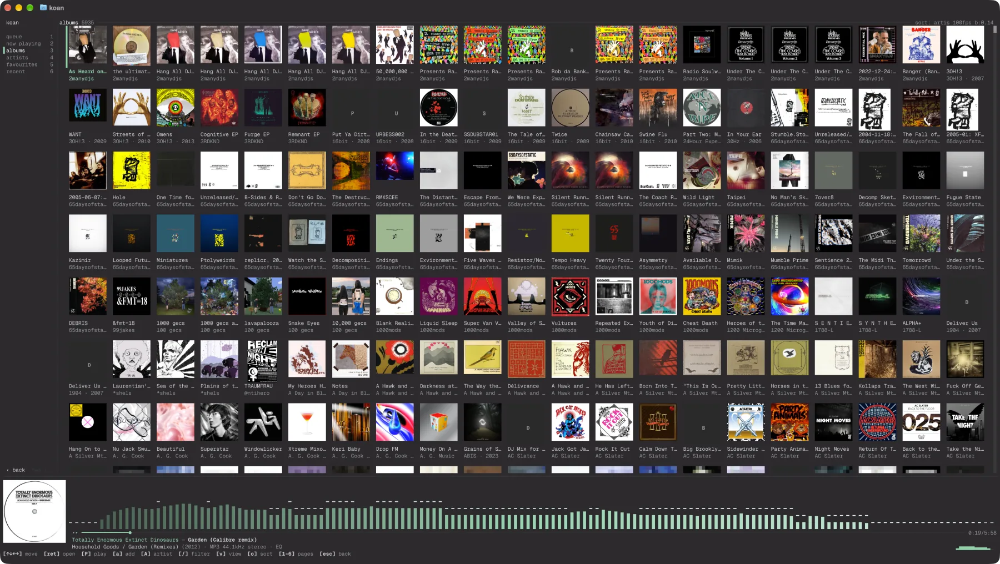
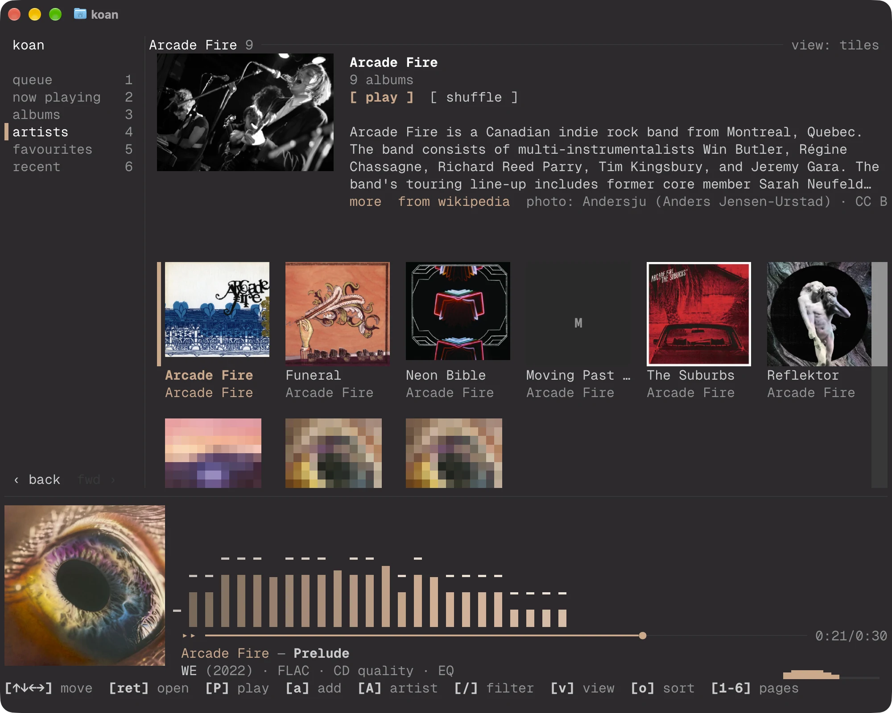
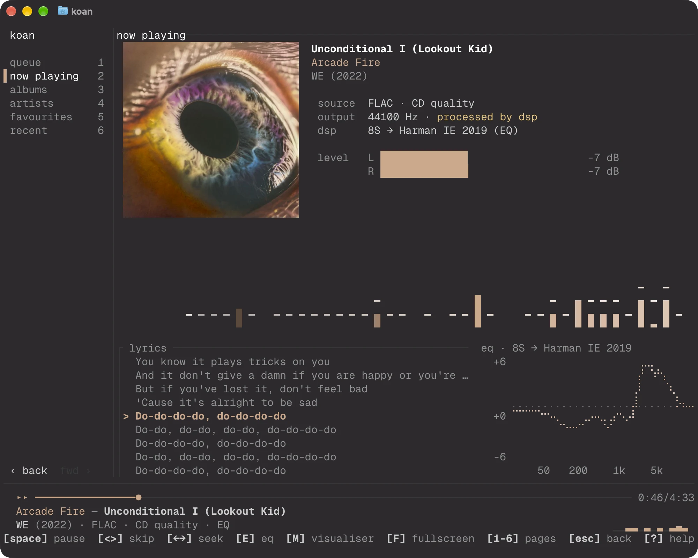

# The terminal UI

The TUI follows the shape of the Mac and mobile apps: pages you move between, a sidebar or tab bar to do it with, and a transport bar that stays put. Everything is reachable by keyboard and by mouse.

## Pages

| Key | Page | What it shows |
|-----|------|---------------|
| `1` | Queue | The queue, grouped by album. Edit, reorder and select here |
| `2` | Now playing | The cover, the signal path, levels, the spectrum, lyrics and the EQ curve |
| `3` | Albums | Every record in the library, as tiles of cover art or as rows |
| `4` | Artists | The library as a tree: artist, album, track |
| `5` | Favourites | Favourited records, or the tracks themselves |
| `6` | Recent | What was played in the last 30 days |
| `7` | History | Every play, newest first, under the day it was played |
| `8` | Settings | The settings that otherwise mean editing `config.toml` |

The wheel and the scrollbars (which can be dragged) scroll every page. Opening a record or an artist (from a tile, a link, or the keys below) goes to the **album page** and the **artist page**. The album page holds the cover, who it is by, its facts and its tracks; the artist page is that artist's photograph and the opening of their Wikipedia article (with `play` and `shuffle`, and a link to the article), above their records as tiles. Both sit under Albums and Artists in the sidebar and in history.

`Tab` and `Shift+Tab` step through the pages. Pages keep a history like a browser: `[` and `]`, or `Alt+Left` and `Alt+Right`, go back and forward, and `Esc` leaves a page for the one before it. Albums, Favourites and Recent are the library's own listings with a filter on, the same ones the apps use, so the three agree about what is on a shelf.

## History and settings

History lists every play, grouped by day. `x` (or the `×` at the end of a row) forgets a play and `D` forgets all of them, on a second press; signed in to a koan server, a forgotten play is forgotten on the account's other devices too, as in the apps. The artist and the record in a row are links, `/` filters by title, artist or record, and `Enter` or a second click plays the track.

Settings holds the playback, terminal, server and device settings that are a choice rather than a path or a password: ReplayGain and pre-amp, fading on pause, the theme, cover graphics and size, the frame counter and rate, the visualiser's colours, syncing, and what other devices on the network may do. `←` and `→` (or the arrows beside each value, or a click on the value) change one, and each is written to the file that owns it, so a setting that belongs to this machine stays out of a `config.toml` you share. Folders and the server account are shown and are set up in the apps or the config.

## Layout

The layout follows the width of the terminal.

- **100 columns or more:** a sidebar beside the page, with back and forward at its foot.
- **56 to 99 columns:** a tab bar over the page. Page names shorten to fit.
- **Under 56 columns:** the tab bar shows page numbers and names only the current page.

The transport bar sits at the foot. Drag the hairline above it to resize the cover; the size is saved to `config.local.toml`.

## Browsing records

Albums, Favourites and Recent draw each record as a tile. `v` switches to rows (tracks, on Favourites and Recent). `o` cycles the order on Albums: artist, date added, title, year. `/` filters what is shown; the heading's `/ filter` does the same with a click.

| Key | Action |
|-----|--------|
| Arrows or `hjkl` | Move |
| `Enter` or `O` | Open the record |
| `A` | Open the artist |
| `P` | Add to the queue and play |
| `a` | Add to the end of the queue |
| `Ctrl+R` | Replace the queue and play |
| `f` | On a list of tracks, favourite or unfavourite |

On the album page `Enter` plays from the track under the cursor to the end of the record; `P` plays all of it, `a` adds it, `Ctrl+R` replaces the queue with it, and `A` opens the artist. The buttons under the title do the same.

### Links

As in the apps, names that lead somewhere are links. Under a tile, the title opens the record and the artist opens the artist; on the album page the artist's name opens them; and in the queue the artist and record in each album heading do. A link is underlined while the pointer is over it. Each has a key too: `O` opens the record and `A` the artist of whatever is selected, in the queue, the Artists tree and the browsing pages.

### Without a right button

Nothing needs a right click. The key hints along the foot are buttons: click `[a] add` and it is the `a` key. A queue row shows a `⋯` at its end when the pointer is over it or it is selected, and clicking that opens the row's menu, which a right click also opens. The scrollbars on the queue and the browsing pages can be clicked and dragged. A right click on a tile still adds it to the queue, as a shortcut.

With the mouse: click selects, a second click opens, the wheel scrolls, and the sort and view labels in the heading are buttons.

## The EQ

`E` opens a list of EQ profiles with the one in use marked. Choosing one plays the output through it, and "off" plays the output untouched; it is the same choice the apps' EQ page and `koan dsp assign` make, so they agree. Editing, importing and measuring profiles still happen in the apps and the CLI. See [DSP](dsp.md).

## Covers

Covers are drawn as real images where the terminal supports the kitty or iTerm2 graphics protocol (Ghostty, kitty, WezTerm and iTerm2 do). Sixel is not used. Elsewhere, and whenever `playback.art_graphics` is off, they are drawn in half blocks: two pixels to a cell, which is blocky and has a charm of its own. `I` switches between the two for the session and saves the choice.

Graphics are detected once at startup by asking the terminal, which can add a moment on a terminal that does not answer. Setting `art_graphics = false` skips the question.

## Colour

The palette is the [kōan theme](https://github.com/radiosilence/koan/blob/main/docs/design/koan-theme.md). While a record plays, the accent takes its colour from the cover; a sleeve with no colour in it leaves the accent mint. The visualizers follow it too: the default `theme` palette runs from a dark shade of the accent through the accent to a light tint, in every mode, and the heat maps and matrix rain draw in it as well. `visualizer.palette = "rainbow"` is the old frequency rainbow, and `mono`, `fire` and `neon` are as they were. Where the terminal reports 24-bit colour the theme is drawn exactly, and in the nearest of the 256 colours otherwise. `playback.tui_theme = "ansi"` returns to the terminal's own sixteen colours. The theme never paints a background, so the terminal's own shows through.

## Now playing

The transport bar shrinks to its three lines here, since the page has the cover and the spectrum. The signal path is the part to read. **source** is the file's format. **output** is the rate the device was given, and says `bit-perfect ✓` only when nothing stands between the file and the device. If the output is resampled, DSP is running, or ReplayGain is on, it says which instead. When a DSP profile is active, its frequency response is plotted beside the lyrics, headed with the profile's name and a frequency axis; `E` changes the profile.

The transport bar carries a small spectrum at the end of its album line.
